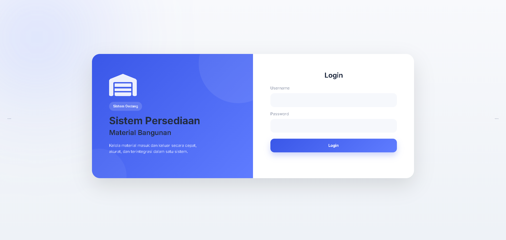
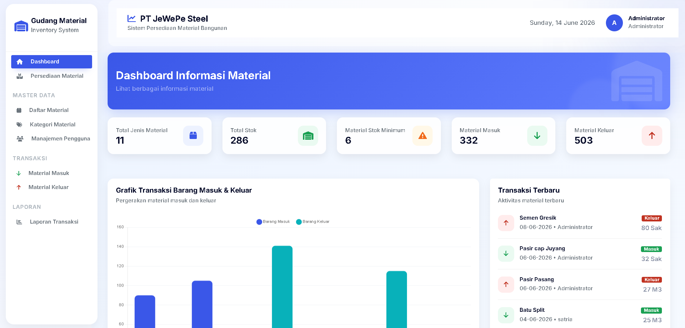
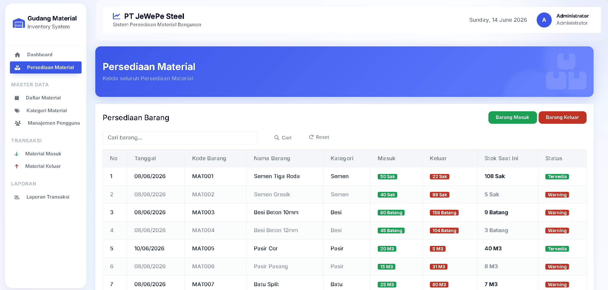
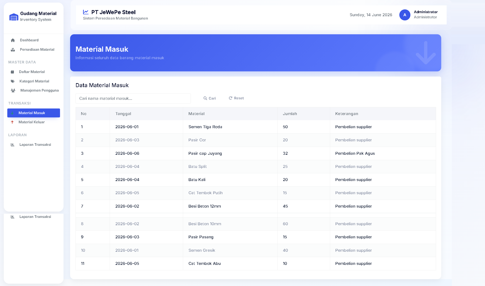
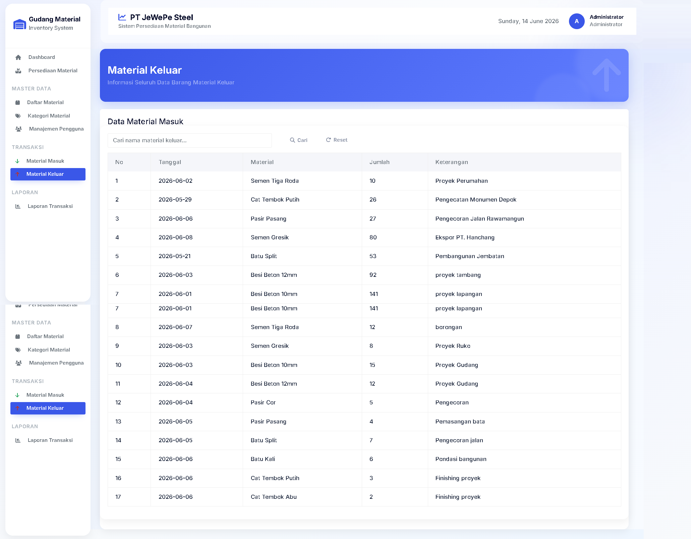
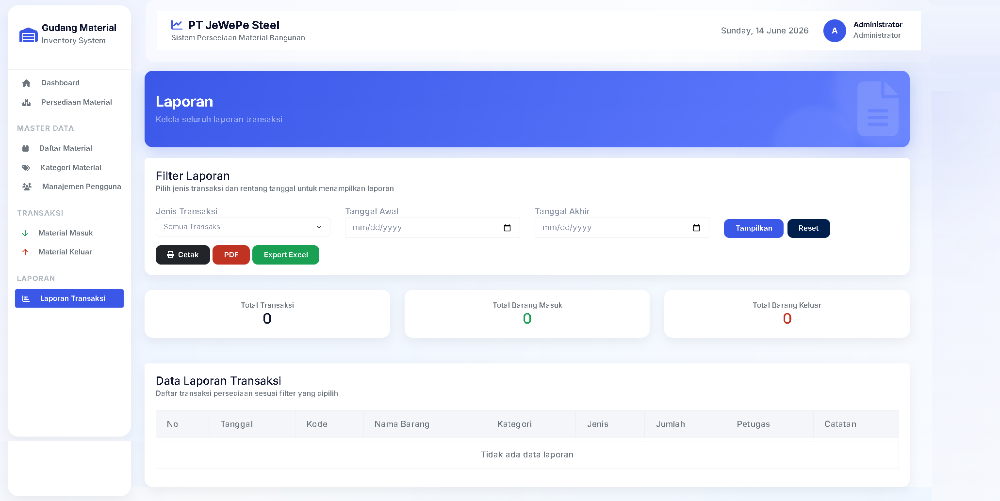

# Aplikasi Persediaan Gudang

Aplikasi manajemen persediaan gudang berbasis web yang dibangun menggunakan Laravel. Aplikasi ini memudahkan pencatatan barang masuk, barang keluar, monitoring stok, serta pembuatan laporan transaksi dalam berbagai format.

---

## Tech Stack

| Layer | Teknologi |
|---|---|
| Backend Framework | Laravel  |
| Frontend | Blade + Tailwind CSS v4 |
| Build Tool | Vite |
| Database | SQLite (default) / MySQL |
| Export PDF | barryvdh/laravel-dompdf |
| Auth | Custom (AuthController + Role Middleware) |

---

## Fitur

- **Login & Autentikasi** — sistem login dengan role-based access (Admin & Petugas)
- **Dashboard** — ringkasan total stok, barang masuk/keluar, status stok minimum & aman, grafik transaksi harian, dan 5 transaksi terbaru
- **Manajemen Material** — CRUD data material dengan kode, nama, satuan, dan stok minimum
- **Kategori** — CRUD kategori material
- **Barang Masuk** — pencatatan material masuk ke gudang beserta tanggal dan keterangan
- **Barang Keluar** — pencatatan material keluar dari gudang beserta tanggal dan keterangan
- **Persediaan Barang** — halaman monitoring stok seluruh material
- **Laporan Transaksi** — filter berdasarkan rentang tanggal dan jenis transaksi (masuk/keluar/semua)
- **Export Laporan** — download laporan dalam format **PDF**, **Excel (.xlsx)**, dan **CSV**
- **Cetak Laporan** — tampilan print-friendly langsung dari browser
- **Manajemen User** — khusus Admin: CRUD data pengguna

---

## Screenshots

### Login


### Dashboard


### Daftar Barang


### Barang Masuk


### Barang Keluar


### Halaman Laporan


---

## Struktur Proyek

```
aplikasi-persediaan-gudang/
├── app/
│   ├── Exports/
│   │   └── LaporanTransaksiExport.php   # Export Excel
│   ├── Http/Controllers/
│   │   ├── Admin/
│   │   │   ├── DashboardController.php
│   │   │   ├── CategoryController.php
│   │   │   ├── MaterialController.php
│   │   │   ├── IncomingMaterialController.php
│   │   │   ├── OutgoingMaterialController.php
│   │   │   ├── ReportController.php     # Laporan + export PDF/Excel/CSV
│   │   │   └── UserController.php
│   │   └── AuthController.php
│   └── Models/
│       ├── User.php
│       ├── Role.php
│       ├── Category.php
│       ├── Material.php
│       ├── IncomingMaterial.php
│       └── OutgoingMaterial.php
├── database/migrations/
├── resources/views/
├── routes/web.php
└── screenshots/
```

---

## Instalasi & Setup

### Prasyarat
- PHP >= 8.2
- Composer
- Node.js & npm

### 1. Clone repository

```bash
git clone https://github.com/username/aplikasi-persediaan-gudang.git
cd aplikasi-persediaan-gudang
```

### 2. Setup otomatis

```bash
composer run setup
```

Perintah ini akan otomatis menjalankan:
- `composer install`
- Copy `.env.example` → `.env`
- Generate `APP_KEY`
- Jalankan migrasi database
- `npm install`
- `npm run build`

### 3. Konfigurasi `.env`

Secara default aplikasi menggunakan **SQLite** (tidak perlu konfigurasi database tambahan).

Jika ingin menggunakan MySQL, ubah bagian ini di `.env`:

```env
DB_CONNECTION=mysql
DB_HOST=127.0.0.1
DB_PORT=3306
DB_DATABASE=persediaan_gudang
DB_USERNAME=root
DB_PASSWORD=
```

### 4. Jalankan aplikasi

```bash
composer run dev
```

Buka [http://localhost:8000](http://localhost:8000) di browser.

---

## Role Pengguna

| Role | Akses |
|---|---|
| `Admin` | Semua fitur termasuk manajemen user |
| `Petugas` | Dashboard, material, barang masuk/keluar, laporan |

---

## Database

| Tabel | Keterangan |
|---|---|
| `users` | Data pengguna |
| `roles` | Role (Admin, Petugas) |
| `categories` | Kategori material |
| `materials` | Data material + stok + stok minimum |
| `incoming_materials` | Pencatatan barang masuk |
| `outgoing_materials` | Pencatatan barang keluar |

---

## Testing

```bash
composer run test
# atau
php artisan test
```
